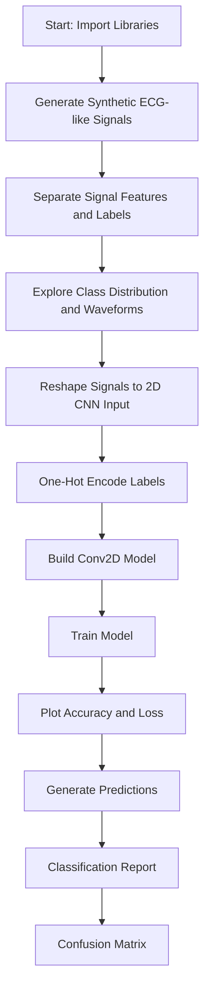

<div align="center">

# ❤️ ECG Heartbeat Classification

### Deep Learning-Based Heartbeat Pattern Classification with a 2D CNN

<p>
  
  
  
  
</p>

**An educational deep-learning project that explores the classification of ECG-like heartbeat signals into five predefined categories.**

</div>

---

## 📌 Project Overview

Electrocardiography (ECG) records the electrical activity of the heart over time. ECG waveforms contain patterns that can be studied to understand different heartbeat types.

This project builds a neural-network workflow to classify fixed-length, one-dimensional heartbeat signals into five categories. It uses Python and TensorFlow/Keras to prepare the signal data, construct a Convolutional Neural Network (CNN), train the model, and visualize its classification performance.

> **Important dataset note:** The currently uploaded notebook generates synthetic ECG-like signals with NumPy. It does **not** download or use the real MIT-BIH Arrhythmia Database. Therefore, its results are demonstrations on synthetic data and must not be interpreted as clinical performance or MIT-BIH benchmark results.

## 🎯 Project Objectives

- Generate and explore fixed-length ECG-like signal samples.
- Visualize the distribution of the five heartbeat labels.
- Compare representative signal patterns across classes.
- Prepare signal arrays and one-hot encoded targets for a CNN.
- Build and train a 2D Convolutional Neural Network.
- Evaluate predictions using a classification report and confusion matrix.
- Visualize training accuracy and loss over epochs.

## 🧠 Heartbeat Categories

The notebook uses the following numeric-label mapping:

| Label | Category | Abbreviation |
|:---:|---|:---:|
| `0` | Normal | N |
| `1` | Supraventricular Premature | S |
| `2` | Premature Ventricular Contraction | V |
| `3` | Fusion Beat | F |
| `4` | Unclassifiable Beat | Q |

These are the class names assigned by the notebook. Because the current samples are synthetic, they should not be treated as medically annotated real heartbeats.

## 🗂️ Project Workflow



## 🧰 Tech Stack

| Technology | Purpose |
|---|---|
| **Python** | Main programming language |
| **NumPy** | Numerical operations and synthetic signal generation |
| **Pandas** | Organizing generated samples in tabular form |
| **Matplotlib** | Plotting ECG waveforms and training curves |
| **Seaborn** | Statistical plots and confusion-matrix heatmap |
| **TensorFlow / Keras** | Building and training the CNN |
| **scikit-learn** | Classification report and confusion matrix |
| **Jupyter Notebook** | Interactive development environment |

## 🏗️ Model Architecture

The notebook defines a Sequential **2D CNN**. Each signal contains 187 values and is reshaped to `(187, 1, 1)` before being passed to the model.

| Layer | Configuration |
|---|---|
| Input | `187 × 1 × 1` |
| Conv2D | 64 filters, kernel size `(6, 1)`, ReLU, same padding |
| Batch Normalization | After first convolution |
| MaxPooling2D | Pool size `(2, 1)` |
| Conv2D | 128 filters, kernel size `(3, 1)`, ReLU, same padding |
| Batch Normalization | After second convolution |
| MaxPooling2D | Pool size `(2, 1)` |
| Flatten | Converts feature maps into a vector |
| Dense | 128 units, ReLU |
| Dropout | Rate `0.35` |
| Output | 5 units, Softmax |

### Training Configuration

| Parameter | Value |
|---|---:|
| Training samples | 500 |
| Test samples | 100 |
| Samples per signal | 187 |
| Number of classes | 5 |
| Epochs | 15 |
| Batch size | 32 |
| Optimizer | Adam |
| Learning rate | 0.001 |
| Loss function | Categorical cross-entropy |
| Metric | Accuracy |

## 📊 Notebook Visualizations

The notebook generates the following visual outputs:

1. **Class distribution:** Number of generated samples assigned to each class.
2. **Representative waveforms:** One generated signal example for each available class.
3. **Training and validation accuracy:** Accuracy tracked across epochs.
4. **Training and validation loss:** Categorical cross-entropy tracked across epochs.
5. **Confusion matrix:** Heatmap comparing actual generated labels with predicted labels.

The classification report also displays precision, recall, F1-score, and support for each class.

*Metric values are intentionally not included here because they depend on the actual notebook execution and are not hard-coded in this README.*

## 🚀 Getting Started

### 1. Clone the repository

```bash
git clone <your-repository-url>
cd <your-repository-folder>
```

### 2. Create a virtual environment (recommended)

```bash
python -m venv .venv
```

Activate it:

**Windows**
```bash
.venv\Scripts\activate
```

**macOS / Linux**
```bash
source .venv/bin/activate
```

### 3. Install dependencies

```bash
pip install numpy pandas matplotlib seaborn scipy tensorflow scikit-learn jupyter
```

### 4. Launch Jupyter Notebook

```bash
jupyter notebook
```

Open the project `.ipynb` file and run the cells from top to bottom.

## 📁 Suggested Repository Structure

```text
ECG-Heartbeat-Classification/
│
├── ecg_heartbeat_classification.ipynb
├── README.md
├── requirements.txt
│
└── assets/
    ├── class_distribution.png
    ├── sample_waveforms.png
    ├── training_accuracy.png
    ├── training_loss.png
    └── confusion_matrix.png
```

The `assets/` images can be added after exporting the corresponding notebook plots. The notebook itself currently displays plots inline.

## ⚠️ Limitations & Important Considerations

- **Synthetic data:** The notebook creates 500 training and 100 test samples using a mathematical signal-generation function and Gaussian noise. It does not currently load real ECG recordings.
- **Not clinically validated:** Synthetic-data results do not establish the ability to identify real arrhythmias or support medical decisions.
- **Validation leakage:** The current training cell passes the test set as `validation_data` to `model.fit`. This means the test set is observed during training. For a reliable final evaluation, split the training data into training and validation subsets, then reserve the test set for final evaluation only.
- **Synthetic class balance:** Labels are sampled using probabilities `[0.70, 0.10, 0.08, 0.07, 0.05]`, so the generated classes are intentionally imbalanced.
- **Reproducibility:** NumPy is seeded with `42` for data generation. TensorFlow model initialization and training are not explicitly seeded in the current notebook.

## 🔮 Future Improvements

- Replace the synthetic generator with a documented real ECG dataset, such as the MIT-BIH Arrhythmia Database.
- Use patient-wise or record-wise train/validation/test splitting when working with real recordings.
- Keep the final test set completely separate from model training and model selection.
- Add class-wise performance analysis and consider class weighting where appropriate.
- Compare the current 2D CNN with a 1D CNN and conventional machine-learning baselines.
- Add model checkpointing and save the trained model.
- Create an inference interface for appropriately formatted ECG segments.
- Record dataset provenance, preprocessing steps, software versions, and experiment settings.

## 📚 References & Resources

- [TensorFlow Documentation](https://www.tensorflow.org/)
- [Keras Documentation](https://keras.io/)
- [NumPy Documentation](https://numpy.org/doc/)
- [Pandas Documentation](https://pandas.pydata.org/docs/)
- [Matplotlib Documentation](https://matplotlib.org/stable/)
- [Seaborn Documentation](https://seaborn.pydata.org/)
- [scikit-learn Documentation](https://scikit-learn.org/stable/)

For future experiments using real ECG data, consult the [PhysioNet MIT-BIH Arrhythmia Database](https://physionet.org/content/mitdb/1.0.0/), and follow its access and citation requirements.

---

<div align="center">

### Built with Python, TensorFlow & curiosity ❤️

**ECG Heartbeat Classification — Academic Machine Learning Project**

</div>
